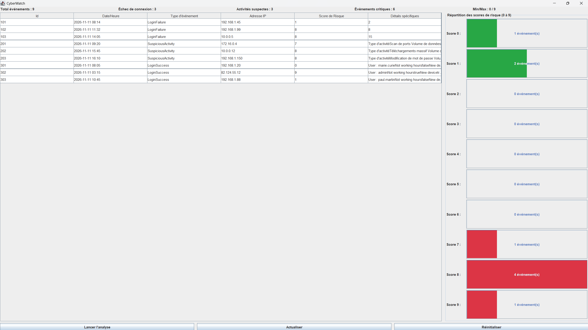

# CyberWatch

Mini tableau de bord Java qui affiche des événements de cybersécurité fictifs et les classe par niveau de risque, pour apprendre à construire un petit centre de surveillance simulé.

> **Projet en cours** : le début de l'application prend forme, le reste va suivre plus tard.

## Aperçu



## Fonctionnalités

- Affiche un journal d'événements de sécurité : connexions réussies, échecs de connexion, activités suspectes.
- Calcule un score de risque de 0 à 9 pour chaque événement.
- Compte les événements par type et repère les événements critiques (score de 7 ou plus).
- Montre la répartition des scores dans un graphique en barres vert, orange ou rouge.

## Prérequis

- Un JDK (Java Development Kit) récent. Le code a été compilé avec le JDK 21.
- Un environnement graphique : la fenêtre utilise Swing.

## Installation

Place-toi dans le dossier qui contient les fichiers `.java`, puis compile-les :

```bash
javac *.java
```

## Utilisation

```bash
java Main
```

Une fenêtre s'ouvre avec 9 événements d'exemple : les statistiques en haut, le journal et le graphique au centre, trois boutons en bas. Les boutons réagissent au clic ; leurs actions complètes seront ajoutées plus tard.

Dans un IDE (IntelliJ, Eclipse, VS Code), lance la classe `Main`.

## Technologies

Java, interface graphique Swing.